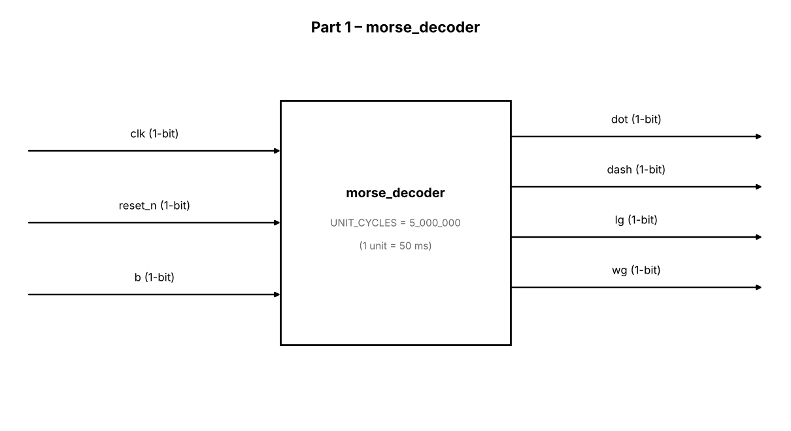
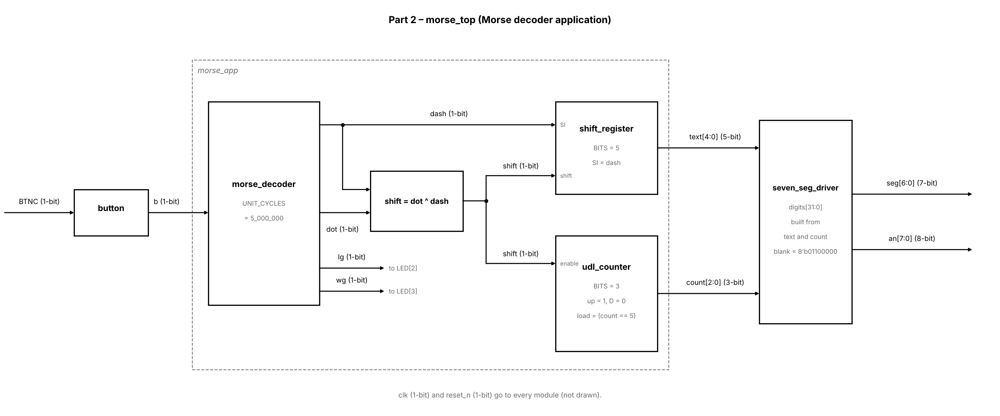

# Lab 10 – Morse Decoder

**Course:** ECE 2300L – Digital Logic Design Laboratory
**Board:** Nexys A7-100T
**Tools:** Verilog, Xilinx Vivado

## Files

| File | Description |
|---|---|
| [`morse_decoder.v`](verilog/design/morse_decoder.v) | Morse decoder: converts button input `b` into `dot`, `dash`, `lg` and `wg` pulses |
| [`morse_app.v`](verilog/design/morse_app.v) | Part 2 circuit: decoder, `shift = dot ^ dash`, 5-bit shift register and 3-bit counter |
| [`shift_register.v`](verilog/design/shift_register.v) | 5-bit shift register with shift enable |
| [`seven_seg_driver.v`](verilog/design/seven_seg_driver.v) | Time-multiplexed driver for the 8 seven-segment digits |
| [`morse_top.v`](verilog/design/morse_top.v) | FPGA top module: button, `morse_app` and seven-segment display |
| [`button.v`](verilog/design/button.v) | Synchronizer, debouncer and edge detector for a push button |
| [`debouncer_delayed.v`](verilog/design/debouncer_delayed.v) | 20 ms delayed debouncer |
| [`debouncer_delayed_fsm.v`](verilog/design/debouncer_delayed_fsm.v) | FSM used by the debouncer |
| [`edge_detector.v`](verilog/design/edge_detector.v) | Rising and falling edge detector |
| [`synchronizer.v`](verilog/design/synchronizer.v) | Two-stage input synchronizer |
| [`timer_parameter.v`](verilog/design/timer_parameter.v) | Parameterized timer |
| [`udl_counter.v`](verilog/design/udl_counter.v) | Up/down/load counter |
| [`tb_morse_decoder.v`](verilog/sim/tb_morse_decoder.v) | Testbench for `morse_decoder` |
| [`tb_morse_app.v`](verilog/sim/tb_morse_app.v) | Testbench for `morse_app` |
| [`morse_top.xdc`](verilog/constraints/morse_top.xdc) | Pin constraints for the Nexys A7-100T |

## Part 1 – Morse Decoder

A decoder that times how long input `b` is high and low and outputs one-clock pulses: `dot` (under 3 units), `dash` (3 or more units), `lg` (3-unit gap) and `wg` (7-unit gap), with 1 unit = 50 ms. It was verified with a testbench that applies dots, dashes, letter gaps and word gaps and checks the printed pulses.

**Simulation screenshot:**

**Block diagram:**

## Part 2 – Morse Decoder Application

The decoder drives a 5-bit shift register (`dot` shifts in 0, `dash` shifts in 1) and a 3-bit counter that counts the symbols and reloads 0 after 5. The shift register is shown on the first 5 seven-segment digits and the counter on the 8th, with `b` connected to a push button. It was verified in simulation by entering the letters A, C and 0, and then on the FPGA.

**Simulation screenshot:**

**Block diagram:**

**Demo video:**

